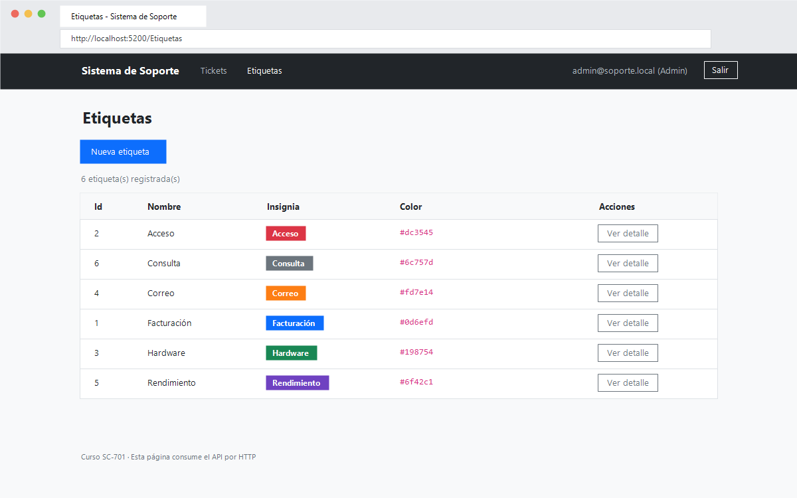
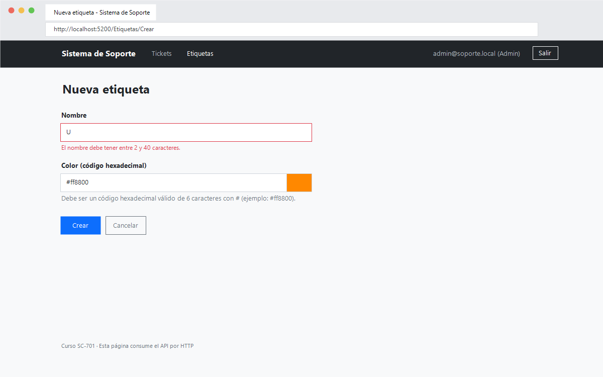
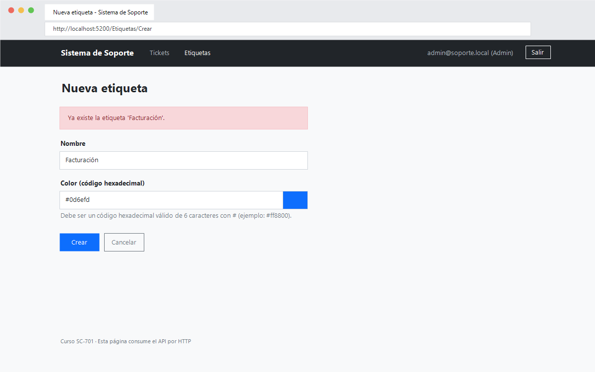

# Práctica Programada 3: Etiquetas en el MVC
**Curso:** SC-701 Programación Avanzada Web (.NET)  
**Estudiante:** Héctor  
**Rama de trabajo:** `practica3`

---

## 4. Parte B: Investigación

### 1. ¿Qué es el patrón Post-Redirect-Get y qué problema concreto evita? Explíquelo con lo que pasaría si lo omite y el usuario presiona F5.

El patrón Post-Redirect-Get (PRG) es un patrón de diseño para aplicaciones web que desacopla el procesamiento de datos enviados por un formulario de la presentación de la respuesta. Cuando el navegador envía una petición `POST` al servidor y la operación se procesa con éxito, en lugar de retornar directamente la vista HTML como cuerpo de la respuesta HTTP, el controlador emite una respuesta de redirección (HTTP 302 o 303) hacia una acción de consulta `GET` (por ejemplo, la vista de detalle o la lista).

Este patrón evita el problema concreto del **doble envío de formularios** (*duplicate form submission*). Si se omitiera el patrón y el controlador retornara directamente `View(...)` en la acción `POST`, la última petición registrada en el historial del navegador continuaría siendo un `POST`. Si el usuario presiona F5 o el botón de recargar, el navegador mostrará el cuadro de diálogo de confirmación de reenvío de formulario y repetirá exactamente la misma petición `POST`. Esto provocaría que la entidad se intente crear una segunda vez en la base de datos, generando registros duplicados o desencadenando un error 409 de conflicto.

*Fuente:* [Microsoft Learn - Handling Form Submissions and Post-Redirect-Get in ASP.NET Core](https://learn.microsoft.com/aspnet/core/mvc/controllers/actions)

---

### 2. El cliente tipado se registra con `AddHttpClient<TInterfaz, TImplementacion>`. ¿Qué tiempo de vida (Transient, Scoped o Singleton) tiene y por qué no conviene que sea Singleton ni crear `new HttpClient()` a mano?

Al registrar un cliente tipado mediante `AddHttpClient<IEtiquetasApi, EtiquetasApi>`, la clase del cliente se registra en el contenedor de inyección de dependencias con un tiempo de vida **Transient** (transitorio). Esto significa que se crea una nueva instancia cada vez que se solicita o inyecta en un controlador. Sin embargo, el manejador de mensajes HTTP subyacente (`HttpMessageHandler` / `SocketsHttpHandler`) es administrado internamente por `IHttpClientFactory` mediante un grupo o *pool* de manejadores cuyo ciclo de vida rota automáticamente (por defecto cada 2 minutos).

No conviene registrar el cliente como **Singleton** porque mantendría vivas las conexiones TCP de forma indefinida, provocando que no respete los cambios en el sistema de nombres de dominio (**DNS refresh / staleness problem**). Si un servicio externo o API cambia su dirección IP, un cliente Singleton continuaría enviando peticiones a la dirección IP obsoleta sin actualizarse. Por otro lado, tampoco conviene crear instancias manuales con `new HttpClient()` debido al **agotamiento de sockets** (*socket exhaustion*): aunque el objeto se deseche con `Dispose()`, el sistema operativo mantiene los sockets TCP subyacentes en estado `TIME_WAIT` durante varios minutos, bloqueando los puertos efímeros disponibles y causando que la aplicación falle bajo una carga concurrente.

*Fuente:* [Microsoft Learn - Make HTTP requests using IHttpClientFactory in ASP.NET Core](https://learn.microsoft.com/aspnet/core/fundamentals/http-requests)

---

### 3. ¿Qué es ProblemDetails (RFC 9457)? Nombre los campos que su MVC lee y diga cuál es la diferencia entre el formato de un 400 de validación y el de un 409.

`ProblemDetails` es una especificación estandarizada por el IETF (RFC 9457, que actualizó al RFC 7807) para definir un formato legible por máquinas y humanos para reportar errores y detalles de problemas en respuestas de APIs HTTP, utilizando el tipo de medio `application/problem+json`. Su objetivo es brindar una estructura consistente y predecible para que los clientes interpreten cualquier fallo devuelto por el servidor sin requerir esquemas propietarios por cada endpoint.

En nuestro proyecto MVC, a través de la clase `ApiException` y el modelo interno `ProblemaApi`, la aplicación lee los siguientes campos del JSON devuelto:
- **`title`**: resumen breve y legible del tipo de problema ocurrido.
- **`detail`**: descripción detallada con la explicación concreta del error.
- **`errors`**: diccionario de listas de cadenas (`Dictionary<string, string[]>`) con los mensajes de error asociados a propiedades o campos individuales.

La diferencia principal entre un error 400 y un 409 radica en su estructura:
- Un **400 (Bad Request)** originado por validaciones del modelo usa la variante `ValidationProblemDetails`, la cual incluye el objeto **`errors`** donde cada clave corresponde al nombre de la propiedad inválida (por ejemplo, `"Nombre": ["El nombre debe tener entre 2 y 40 caracteres."]`) y permite al MVC ubicar el mensaje de error exactamente debajo del campo infractor en el formulario.
- Un **409 (Conflict)** corresponde a un conflicto de estado en la lógica de negocio (por ejemplo, un nombre de etiqueta que ya existe en la base de datos). No incluye el diccionario `errors`; en su lugar, transporta el mensaje explicativo en el campo **`detail`** (por ejemplo, `"Ya existe la etiqueta 'Facturación'."`), el cual el controlador del MVC agrega a `ModelState` con clave vacía (`string.Empty`) para que se muestre en el resumen general de validación (`asp-validation-summary="ModelOnly"`).

*Fuente:* [IETF RFC 9457 - Problem Details for HTTP APIs](https://www.rfc-editor.org/rfc/rfc9457.html) | [Microsoft Learn - Handle errors in ASP.NET Core web APIs](https://learn.microsoft.com/aspnet/core/web-api/handle-errors)

---

### 4. ¿Qué ataque previene `[ValidateAntiForgeryToken]`? Explique cómo lo hace ASP.NET Core y qué se pone en el formulario.

El atributo `[ValidateAntiForgeryToken]` previene ataques de **Falsificación de Petición en Sitios Cruzados** (*Cross-Site Request Forgery* o CSRF/XSRF). En este tipo de ataque, un sitio web malicioso aprovecha que el navegador del usuario almacena cookies de autenticación activas para enviar solicitudes no autorizadas (como crear registros, modificar datos o transferir información) a una aplicación legítima sin el conocimiento del usuario.

ASP.NET Core mitiga este riesgo implementando el patrón del **doble token** (*synchronizer token pattern*):
1. Cuando el servidor renderiza el formulario, genera un valor criptográfico aleatorio y seguro.
2. Este valor se envía al cliente en dos lugares diferentes: dentro de una cookie HTTP exclusiva (`.AspNetCore.Antiforgery`) y dentro de un campo oculto en el cuerpo del formulario.
3. Cuando el usuario envía la petición `POST`, el filtro `[ValidateAntiForgeryToken]` intercepta la llamada y verifica que el valor enviado en el formulario coincida con el valor presente en la cookie. Como los sitios web de otros dominios no pueden acceder ni leer las cookies de nuestro dominio debido a la política de mismo origen (*Same-Origin Policy*), no pueden generar un token válido para el formulario, y cualquier intento externo es rechazado con un código de error HTTP 400.

En el formulario HTML se coloca un campo oculto con la siguiente estructura:
```html
<input name="__RequestVerificationToken" type="hidden" value="CfDJ8..." />
```
En ASP.NET Core MVC, al utilizar el Tag Helper de Razor en una etiqueta `<form method="post">`, este campo se genera e inyecta de forma automática.

*Fuente:* [Microsoft Learn - Prevent Cross-Site Request Forgery (XSRF/CSRF) attacks in ASP.NET Core](https://learn.microsoft.com/aspnet/core/security/anti-request-forgery)

---

### 5. Compare `ViewData`, `ViewBag`, `TempData` y un modelo tipado: ¿cuándo usaría cada uno? Dé un ejemplo de su propia práctica.

- **Modelo tipado (`@model`):**  
  *Cuándo usarlo:* Es el mecanismo principal y recomendado para transferir datos de dominio o formularios entre el controlador y la vista. Ofrece seguridad de tipos en tiempo de compilación, detección temprana de errores mediante IntelliSense y validación automática de anotaciones de datos (*Data Annotations*).  
  *Ejemplo en la práctica:* En `EtiquetasController`, se envía `List<EtiquetaVm>` a la vista `Index` para renderizar la tabla de etiquetas, y se recibe `EtiquetaCrearVm` en la acción `Crear` para validar los campos `Nombre` y `Color`.

- **`ViewData`:**  
  *Cuándo usarlo:* Es un diccionario de objetos clave-valor (`ViewDataDictionary`) cuyo ciclo de vida está limitado exclusivamente a la petición HTTP actual. Es ideal para transmitir pequeñas cantidades de metadatos o configuraciones visuales desde la acción hacia el layout o vistas parciales que no pertenecen al modelo principal.  
  *Ejemplo en la práctica:* En las vistas `Index.cshtml`, `Crear.cshtml` y `Detalle.cshtml`, se utiliza `ViewData["Title"] = "Etiquetas"` para que la plantilla principal `_Layout.cshtml` configure dinámicamente la etiqueta `<title>` de la pestaña del navegador.

- **`ViewBag`:**  
  *Cuándo usarlo:* Es un contenedor dinámico (`dynamic`) construido sobre `ViewData` que permite acceder a los valores con sintaxis de propiedades (por ejemplo, `ViewBag.Title = ...`). Se utiliza para pasar información auxiliar sin necesidad de declarar llaves de diccionario, aunque carece de comprobación estática de tipos en tiempo de compilación y no cuenta con autocompletado.

- **`TempData`:**  
  *Cuándo usarlo:* Es un diccionario (`ITempDataDictionary`) respaldado por cookies o sesión que persiste datos a través de una redirección HTTP. El dato se conserva hasta que es leído en la petición subsiguiente y luego se descarta. Es el componente fundamental para mostrar mensajes informativos, de confirmación o alerta cuando se implementa el patrón Post-Redirect-Get.  
  *Ejemplo en la práctica:* En `EtiquetasController.cs`, tras crear satisfactoriamente una etiqueta en el método `Crear (POST)`, se almacena `TempData["Exito"] = $"Etiqueta '{creada.Nombre}' creada con éxito."` antes de ejecutar `RedirectToAction(nameof(Detalle), new { id = creada.Id })`, permitiendo que la vista `Detalle` renderice la alerta de confirmación tras la redirección.

*Fuente:* [Microsoft Learn - Passing data to views in ASP.NET Core MVC](https://learn.microsoft.com/aspnet/core/mvc/views/overview#passing-data-to-views)

---

## 5. Evidencias de Funcionamiento

Las capturas de pantalla generadas se encuentran almacenadas dentro del directorio `docs/evidencia/`:

1. **Lista de etiquetas con vista parcial funcionando:**  
   Muestra la tabla de etiquetas registradas en el sistema, donde la columna *Insignia* hace uso de la vista parcial `_InsigniaColor` renderizando el color hexadecimal correspondiente de cada etiqueta.  
   

2. **Formulario con error de validación bajo un campo:**  
   Muestra el formulario de creación de etiqueta cuando se ingresa un valor no válido (por ejemplo, un nombre de solo 1 carácter), exhibiendo el mensaje de validación correspondiente justo debajo del campo de texto.  
   

3. **Formulario con mensaje de nombre repetido (error 409):**  
   Muestra el formulario de creación de etiqueta tras enviar un nombre ya existente en el sistema. El API responde con código HTTP 409 (Conflicto), y el MVC muestra el mensaje de error general dentro del resumen de validación superior.  
   

---

## 8. Declaración de Uso de Herramientas de Apoyo

Para el desarrollo de esta práctica programada se utilizaron las siguientes herramientas y recursos de apoyo:
- **Documentación oficial de Microsoft Learn:** Consulta sobre la configuración de clientes tipados con `IHttpClientFactory`, el manejo de errores mediante `ProblemDetails` (RFC 9457), protección anti-falsificación con tokens CSRF y patrones de arquitectura MVC en .NET 10.
- **Herramientas de línea de comandos de .NET (`dotnet CLI`):** Utilizadas para la compilación, administración de User Secrets (`dotnet user-secrets`), ejecución de migraciones y pruebas automáticas del sistema.
- **Scalar / OpenAPI UI:** Empleado como explorador interactivo del API en `http://localhost:5190/scalar/v1` para verificar los contratos, esquemas de entrada y códigos de respuesta HTTP de los endpoints de Etiquetas.
- **Apuntes y ejemplos de clase (Semanas 9, 10 y 11):** Referencia para la estructuración por capas, el uso del patrón Post-Redirect-Get y el manejo centralizado de excepciones con `ApiException`.
