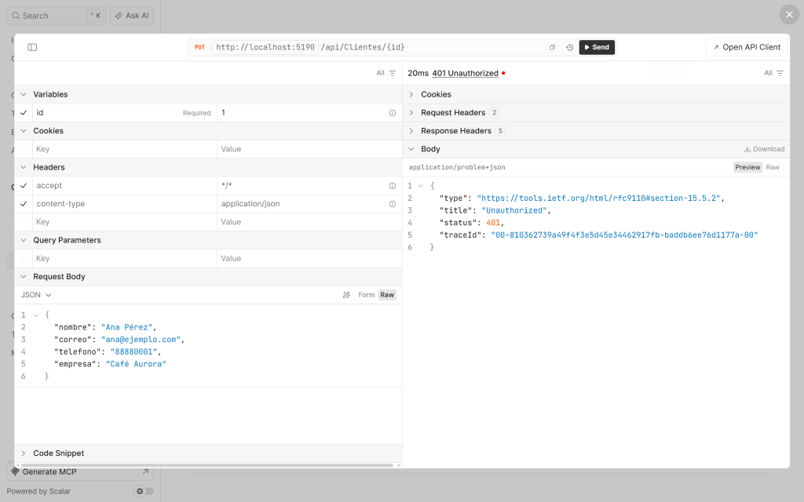
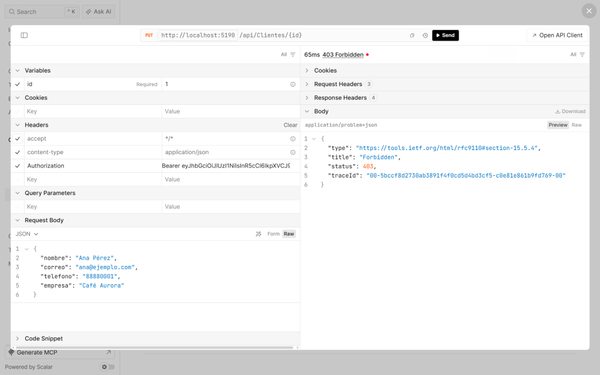
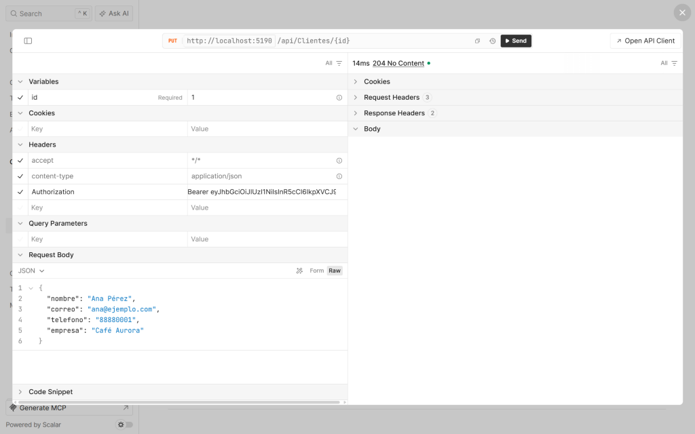

# Práctica Programada 4: Pruebas y seguridad del API

**Curso:** SC-701 Programación Avanzada Web (.NET)  
**Estudiante:** Héctor Méndez  

---

## Parte C: Investigación

### 1. Sal (salt) en el hash de contraseñas e iteraciones de PBKDF2
Una sal (*salt*) es un valor aleatorio y único que se genera por cada usuario y se mezcla con su contraseña antes de calcular el hash. Esto evita los ataques de tablas arcoíris (*rainbow tables*) y de diccionarios precalculados, porque aunque dos usuarios pongan la misma contraseña van a tener hashes completamente distintos en la base de datos. En nuestro código usamos PBKDF2 con SHA-256 y 100 000 iteraciones, pero hoy la guía de OWASP recomienda **600 000 iteraciones** para PBKDF2-HMAC-SHA256. Nuestro valor de 100 000 funciona bien para una práctica académica sin volver lento el servidor, aunque en un sistema real en producción habría que subirlo al estándar actual de OWASP para resistir mejor ataques por fuerza bruta con hardware moderno.
* **Fuente:** OWASP Cheat Sheet Series — [Password Storage - OWASP Cheat Sheet Series](https://cheatsheetseries.owasp.org/cheatsheets/Password_Storage_Cheat_Sheet.html)

### 2. Comparación entre JWT y sesión con cookie
La ventaja principal de un JWT es que es *stateless* (sin estado): toda la información del usuario viaja firmada dentro del propio token, así que el servidor no necesita guardar sesiones en memoria y resulta muy práctico para APIs REST y apps móviles. Su principal riesgo es que, como el servidor no guarda estado, no se puede revocar un token robado de inmediato antes de que expire sin montar una lista negra adicional. En cambio, una sesión con cookie tiene la ventaja de que el servidor controla la sesión en todo momento y puede cerrarla al instante si detecta algo sospechoso, pero su riesgo principal es sufrir ataques CSRF (*Cross-Site Request Forgery*) si no se configuran bien atributos como `SameSite`, `HttpOnly` y `Secure`.
* **Fuente:** Microsoft Learn — [Overview of ASP.NET Core Authentication](https://learn.microsoft.com/en-us/aspnet/core/security/authentication/)

### 3. ¿Qué es un claim y cuáles lleva nuestro token?
Un *claim* es un dato en formato clave-valor que va dentro del *payload* del token y afirma información sobre el usuario autenticado, como su identidad o sus permisos. Revisando nuestra clase `GeneradorTokenJwt`, el token del proyecto agrega explícitamente los *claims* de identificador del usuario (`ClaimTypes.NameIdentifier`), nombre (`ClaimTypes.Name`), correo electrónico (`ClaimTypes.Email`) y rol (`ClaimTypes.Role`), además de los *claims* de vigencia (`nbf`, `exp` e `iat`), emisor (`iss`) y audiencia (`aud`) que añade el manejador JWT al firmar el token. Nunca debe meterse una contraseña ni su hash dentro de un JWT porque el *payload* únicamente está codificado en Base64Url y no cifrado, así que cualquiera que intercepte el token puede decodificarlo y leerlo en segundos.
* **Fuente:** IETF Datatracker — [RFC 7519: JSON Web Token (JWT), Section 4 (JWT Claims)](https://datatracker.ietf.org/doc/html/rfc7519#section-4)

### 4. Diferencia entre los códigos HTTP 401 y 403 en nuestro API
El código **401 Unauthorized** indica que el usuario no se ha autenticado o que su token falta, venció o no es válido, por lo que el API no sabe quién está haciendo la petición. En cambio, el código **403 Forbidden** significa que el API sí validó el token y sabe quién es el usuario, pero su rol no tiene permiso para ejecutar esa operación. Esto se ve directo en nuestras evidencias de la Parte B sobre `PUT /api/clientes/1`: al enviar la petición sin token devolvió **401** por falta de autenticación, mientras que al enviarla con el token válido de `agente@soporte.local` devolvió **403** porque el endpoint solo permite los roles `Admin` o `Supervisor`.
* **Fuente:** MDN Web Docs — [401 Unauthorized - HTTP | MDN](https://developer.mozilla.org/en-US/docs/Web/HTTP/Reference/Status/401) y [403 Forbidden - HTTP | MDN](https://developer.mozilla.org/en-US/docs/Web/HTTP/Reference/Status/403)

### 5. Protección de la clave de firma del JWT
La clave de firma del JWT (`Jwt:Clave`) no se escribe en `appsettings.json` porque ese archivo se sube al repositorio Git y, si alguien obtiene esa clave, podría firmar tokens falsos haciéndose pasar por administrador. En desarrollo local se guarda fuera de la carpeta del proyecto usando **Secret Manager (`dotnet user-secrets`)** de .NET, que la almacena en el perfil local del sistema operativo. En un servidor real o entorno de producción se guarda mediante **variables de entorno** del servidor (por ejemplo en Azure App Service) o en un servicio especializado de bóveda de secretos como **Azure Key Vault**.
* **Fuente:** Microsoft Learn — [Safe storage of app secrets in development in ASP.NET Core](https://learn.microsoft.com/en-us/aspnet/core/security/app-secrets)

---

## Evidencias de la Parte B (`docs/evidencia/`)

1. **Petición `PUT /api/clientes/1` sin token (Respuesta: `401 Unauthorized`):**
   

2. **Petición `PUT /api/clientes/1` con token de `Agente` (Respuesta: `403 Forbidden`):**
   

3. **Petición `PUT /api/clientes/1` con token de `Supervisor` (Respuesta: `204 No Content`):**
   

4. **Petición `PUT /api/clientes/1` con token de `Admin` (Respuesta: `204 No Content`):**
   

---

## Declaración de uso de herramientas de apoyo
Para completar esta práctica se utilizaron como apoyo la documentación oficial de Microsoft Learn (.NET, ASP.NET Core, xUnit y Secret Manager), la documentación de xUnit y Moq, la guía oficial de OWASP (*Password Storage Cheat Sheet*), el estándar RFC 7519 para JWT, MDN Web Docs para códigos HTTP, Scalar y las peticiones `.http` de Visual Studio, además de los apuntes y ejemplos del código base del curso `SistemaSoporte` (`ClienteFlujoTests.cs`).

---

## Parte Opcional: Pruebas de integración
Investigué que `WebApplicationFactory<Program>` arranca el API completo en memoria y permite hacerle peticiones HTTP reales con un `HttpClient`, sin abrir puertos ni usar la red. Para que pudiera encontrar la aplicación tuve que exponer la clase con `public partial class Program { }` al final de `API/Program.cs`, porque con instrucciones de nivel superior queda como `internal`. Otro ajuste fue que `Program.cs` lee la configuración al arrancar, así que la clave JWT de prueba se inyecta con `UseSetting` en una fábrica personalizada (`FabricaApiPrueba`) y se usa el entorno `Testing` para no cargar los user-secrets reales. Para no depender de SQL Server, la fábrica desactiva la migración al iniciar y reemplaza `IUsuarioDA` por un doble en memoria sin usuarios, de modo que el login con credenciales incorrectas devuelve 401 con `application/problem+json` y la ruta protegida sin token también devuelve 401.
* **Fuente:** Microsoft Learn — [Integration tests in ASP.NET Core](https://learn.microsoft.com/en-us/aspnet/core/test/integration-tests)
